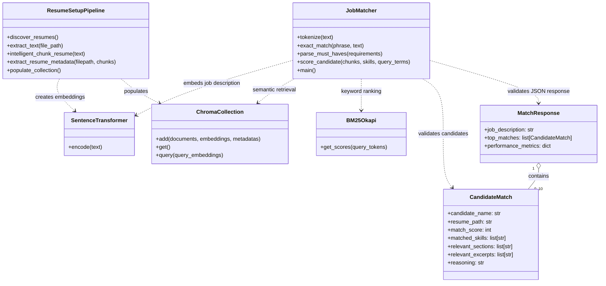

# RAG-Based Profile Matching

A resume-matching project that combines semantic retrieval with BM25 keyword search to rank candidates against a job description. It extracts structured metadata from resumes, applies must-have experience and skill filters, and returns validated JSON with candidate scores and evidence.

## Project Description

The setup pipeline reads resume files from `data/resumes/`, extracts text, splits resumes into sections, and creates an embedding for each section with the `all-MiniLM-L6-v2` Sentence Transformers model. It stores each section and candidate metadata in an in-memory ChromaDB collection.

The matcher compares a job description with the resume collection using both vector similarity and BM25 sparse ranking. Results are grouped by candidate, filtered by required criteria, scored on a 0-100 scale, and returned with matched skills, relevant sections, excerpts, reasoning, and performance metrics.

## Implemented Functionality

- Discovers `.pdf`, `.txt`, `.docx`, and `.doc` files from `data/resumes/`; the current Word parser is `python-docx`, so legacy binary `.doc` files may not be readable without conversion to `.docx`.
- Extracts resume text and divides it into recognizable sections such as skills, experience, education, and projects.
- Generates dense section embeddings using Sentence Transformers.
- Stores documents, embeddings, and extracted candidate metadata in an ephemeral ChromaDB collection.
- Extracts candidate name, skills, approximate experience years, and education using regular-expression and section-based rules.
- Performs hybrid retrieval using ChromaDB semantic ranking and BM25 keyword ranking.
- Supports optional critical skills and hard must-have filters, for example `5+ years Python; AWS`.
- Produces candidate-level 0-100 match scores, matched skills, relevant sections, excerpts, and reasoning.
- Validates the response structure and score range with Pydantic.
- Reports retrieval/scoring latency, score summaries, and a top-10 critical-skill relevance rate.

### Performance Metric Note

`retrieval_accuracy_at_k` is a relevance proxy: the fraction of returned top candidates matching at least one user-declared critical skill. It is not benchmark accuracy measured against human-labeled relevance judgments. It is `null` when no critical skills are provided. `retrieval_latency_ms` measures embedding generation, collection retrieval, ranking, candidate filtering, and scoring; it does not include resume ingestion/model initialization or time spent entering prompts.

## Architecture



## Tools and Libraries

- **Python**: application and test implementation.
- **Sentence Transformers** (`sentence-transformers`): dense resume and job-description embeddings.
- **all-MiniLM-L6-v2**: embedding model used by the setup pipeline.
- **ChromaDB** (`chromadb`): in-memory vector collection and semantic queries.
- **rank-bm25**: BM25 sparse keyword ranking.
- **Pydantic**: validation and JSON serialization for match results.
- **pypdf** and **python-docx**: PDF and Word text extraction.
- **Python `re`, `glob`, and `pathlib`**: section parsing, exact skill checks, file discovery, and paths.
- **Python `unittest`**: automated matcher tests with a fake embedding model and collection.

## Setup

Run commands from the repository root. A Python virtual environment is recommended.

```powershell
python -m venv .venv
.\.venv\Scripts\Activate.ps1
python -m pip install --upgrade pip
python -m pip install pypdf python-docx sentence-transformers chromadb rank-bm25 pydantic numpy
```

The setup script currently also installs some dependencies when it runs. The explicit installation above makes the project requirements clear and ensures `rank_bm25` is available to the matcher.

## Run the Matcher

Run the setup and matcher from the repository root so the relative resume path `data/resumes/` resolves correctly:

```powershell
python job_matcher.py
```

Enter a job description, optional comma-separated critical skills, then semicolon-separated must-haves. For example:

```text
Job description: Backend engineer building Python APIs on AWS
Critical skills: Python, AWS, Docker
Must-have requirements: 5+ years Python; AWS
```

The setup module builds the resume collection when imported by the matcher. ChromaDB is configured as an in-memory client, so the collection is recreated when the process runs and is not persisted between runs.

The output is JSON with this general structure:

```json
{
	"job_description": "Backend engineer building Python APIs on AWS",
	"top_matches": [
		{
			"candidate_name": "Candidate Name",
			"resume_path": "data/resumes/candidate_name.pdf",
			"match_score": 92,
			"matched_skills": ["Python", "AWS"],
			"relevant_sections": ["PROFESSIONAL EXPERIENCE", "TECHNICAL SKILLS"],
			"relevant_excerpts": ["PROFESSIONAL EXPERIENCE: ..."],
			"reasoning": "Hybrid semantic and BM25 relevance score: 92/100."
		}
	],
	"performance_metrics": {
		"retrieval_latency_ms": 120.5,
		"retrieval_accuracy_at_k": 1.0,
		"accuracy_basis": "Critical-skill relevance proxy, not labeled benchmark accuracy."
	}
}
```

## Notebook

`notebooks/RAG_setup_assignment.ipynb` contains the resume ingestion pipeline and a cell-by-cell hybrid matcher walkthrough. Run its setup cells first to populate `collection_filtered`, then run the matching section cells in order.

## Tests

The tests use Python's standard library and do not rebuild the resume index:

```powershell
python -m unittest discover -s tests -v
```

The suite covers exact skill boundaries, must-have parsing and filtering, score validation, JSON metrics, behavior without critical skills, and an empty collection.

## Repository Layout

```text
.
|-- data/
|   |-- job_descriptions/        # Job description data
|   `-- resumes/                 # Input resume files
|-- notebooks/
|   `-- RAG_setup_assignment.ipynb
|-- tests/
|   `-- test_job_matcher.py
|-- job_matcher.py               # Hybrid search and structured match output
|-- rag_setup_assignment.py      # Resume ingestion, embeddings, metadata, ChromaDB
`-- README.md
```

## Limitations

- Experience and skills are estimated using heuristic text parsing; verify extracted metadata before using it for consequential decisions.
- The vector database is in memory and is rebuilt on each matcher process start.
- The reported relevance rate is not a substitute for evaluation against a labeled test set.
- Run the matcher from the project root so its relative data paths resolve as expected.
